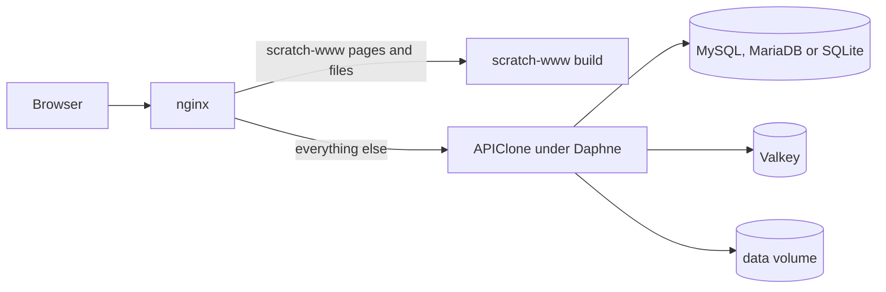

# apiclone-docker

Run [APIClone](https://codeberg.org/heathercat123/apiclone) with the scratch-www frontend in Docker, for development or production.

APIClone is a Django recreation of the backend behind the Scratch website. scratch-www is the website's open source frontend; this repo uses [the APIClone author's fork](https://codeberg.org/heathercat123/scratch-www), which has the changes needed to work with APIClone. This repo only holds the tooling: one Dockerfile, two Compose files, the settings that connect the two projects, and a few scripts. It is not affiliated with or endorsed by the Scratch Foundation.



## Requirements

- Docker with Compose v2 and BuildKit (any current Docker Engine or Docker Desktop).
- Git, for development mode.
- For a production build of scratch-www, about 8 GB of free memory.

## Development

```sh
scripts/dev
```

The first run clones APIClone and scratch-www into `upstream/` at the commits this repo is tested with, builds the images, and starts both dev servers. scratch-www installs its dependencies on the first start, which takes a few minutes; after that it starts in about a minute.

- scratch-www: <http://localhost:8333>
- APIClone (ScratchR2 pages, the admin, the API): <http://localhost:8000>

Edit the checkouts in `upstream/` and the dev servers pick up the changes. To work on checkouts somewhere else, set `APICLONE_SRC` and `WWW_SRC` in `.env` (copy `.env.example` to `.env` first). `scripts/fetch` never touches an existing checkout, so you can switch branches in them freely.

Create an admin account while it runs:

```sh
scripts/manage createsuperuser
```

`scripts/manage` runs any `manage.py` command, for example `scripts/manage shell`. Development data (SQLite database, uploads, mail written to files) lives in a Docker volume; `docker compose down -v` deletes it.

Development uses our `docker/apiclone/local_settings.py`, mounted over `apiclone/local_settings.py` in the checkout. A `local_settings.py` of your own in the checkout is hidden while the stack runs; use `.env` instead.

## Production

1. Copy `.env.example` to `.env` and fill in at least `SITE_URL`, `SECRET_KEY` and `DB_PASSWORD`. Every setting is described there.
2. For HTTPS, put `fullchain.pem` and `privkey.pem` in `certs/` (or the directory `TLS_CERT_DIR` names). Without them, nginx serves plain HTTP, which is what you want behind another proxy that handles TLS.
3. Build and start:

   ```sh
   scripts/prod up -d --build
   ```

   The first build takes several minutes, most of it building scratch-www.
4. Create an admin account:

   ```sh
   scripts/manage --prod createsuperuser
   ```

`scripts/prod` takes any `docker compose` command for the production stack, such as `scripts/prod logs -f` or `scripts/prod down`.

The stack runs:

| Service | What it does |
| --- | --- |
| `proxy` | nginx. Serves the scratch-www build and APIClone's static files, and sends everything else to APIClone. The only service with published ports. |
| `apiclone` | APIClone under Daphne, which also handles the cloud variable WebSockets. |
| `jobs` | Runs APIClone's scheduled jobs (search index, Scratcher promotion, account deletion). |
| `migrate` | Applies database migrations, then exits, before `apiclone` and `jobs` start. |
| `valkey` | Cache and cloud variable messaging. Holds nothing that needs to survive a restart. |
| `mysql` or `mariadb` | The database, depending on `DB_ENGINE`. With SQLite there is none. |

### The database

`DB_ENGINE` picks MySQL (the default), MariaDB or SQLite. SQLite needs no database service and is fine for a small site. To use a database server outside this stack, set `DB_HOST` (and `DB_PORT` if needed); `scripts/backup` and `scripts/restore` then leave the database to you.

PostgreSQL does not work yet: one of APIClone's migrations turns an integer column into a UUID, which PostgreSQL refuses.

### Changing settings

Settings APIClone reads take effect on restart: `scripts/prod up -d`. `SITE_URL` is different. scratch-www bakes it into its build, so after changing it run `scripts/prod up -d --build`.

### Updating

```sh
git pull
scripts/prod up -d --build
```

Migrations run on their own before APIClone starts.

### Backups

```sh
scripts/backup                  # writes backups/<timestamp>/
scripts/restore backups/<timestamp>
```

A backup is a database dump plus an archive of the uploaded files, taken while the site runs. Restoring replaces both, after asking you to confirm (`--yes` skips the question). A backup can only be restored with the same `DB_ENGINE`.

### Source code for your users

scratch-www is licensed under the AGPL-3.0, and the fork used here is a modified version of it. If you run a public site, the AGPL requires you to offer its users the source code of the scratch-www you run. Linking to the commit you built is enough. With the defaults, that is [heathercat123/scratch-www at 2d90f7eb](https://codeberg.org/heathercat123/scratch-www/src/commit/2d90f7ebb3728ed4ea2fdec03de2cdfd391aa6f5). If you change `WWW_REPO` or `WWW_COMMIT`, link to that instead.

The Scratch name, logo and characters are trademarks of the Scratch Foundation (see scratch-www's `TRADEMARK` file). Keep that in mind when you name and brand your site.

## Known issues

These are in APIClone or scratch-www, not in this repo:

- **Cloud variables don't sync between viewers.** APIClone never sends anything on the cloud variable WebSocket, so values are saved but nobody else sees them change.
- **Some pages and API endpoints are missing.** APIClone is a work in progress. For example, the editor asks for a project's visibility and gets a 404, which it survives.

## Building something else

The upstream repositories and commits are pinned in the `Dockerfile`. To build other ones, set `APICLONE_REPO`, `APICLONE_COMMIT`, `WWW_REPO` and `WWW_COMMIT` in `.env`. The Scratch Foundation's own scratch-www mostly works, but signing up needs the fork's captcha bypass, and some links point at scratch.mit.edu.

## Maintenance

- `scripts/lint` runs every linter (shellcheck, shfmt, hadolint, ruff, Compose validation) from their container images.
- `scripts/check-pins` checks that the pins agree with the upstreams.
- `scripts/lock` regenerates the hash-locked Python dependencies in `docker/apiclone/requirements.txt`.
- `tests/smoke.py` tests a running stack end to end. See `.github/workflows/ci.yml` for how CI runs it in both modes.

`AGENTS.md` has the details of how everything fits together, for contributors and coding agents.

## License

0BSD. See `LICENSE`. APIClone and scratch-www have their own licenses (the Unlicense and AGPL-3.0); this repo contains no code from either.
